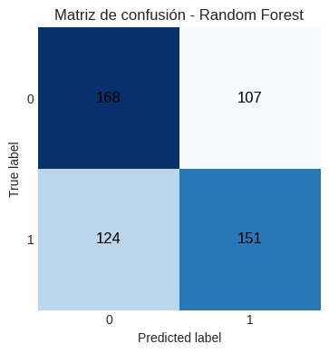
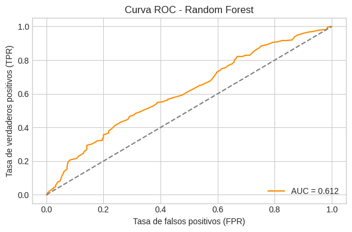

# 🌊 Predicción del tipo de afectación en zonas inundables de Argentina

Clasificación supervisada para predecir si una zona inundable se inunda **parcial** o **totalmente**. El modelo usa variables geoespaciales y ambientales construidas a partir de datos públicos de barrios populares (DU-Techo / RENABAP).

Proyecto final de la materia **Aprendizaje Automático**. Tecnicatura Superior en Ciencia de Datos e IA, Politécnico Malvinas Argentinas (2025).

🎥 **[Video de presentación del proyecto](https://drive.google.com/file/d/1-oxXYCW6Q08yY81oNox5pTJvXcqrL_CQ/view?usp=sharing)** · 📄 **[Informe final (PDF)](reports/informe_final.pdf)**

---

## 🎯 Problema

Saber qué zonas de un barrio sufren **inundación total** sirve para priorizar evacuaciones, asignar recursos y planificar obras. El objetivo es estimar ese riesgo a partir de información territorial disponible públicamente, sin relevamientos en el lugar.

- **Variable objetivo:** `se_inunda_binaria` (1 = parcial, 2 = total). Las clases están balanceadas: 50 % / 50 %.
- **Registros:** 2.746 zonas inundables.

## 🗺️ Datos y variables construidas

| Fuente | Capa | Uso |
|---|---|---|
| [datos.gob.ar — Factores de riesgo en barrios populares](https://www.datos.gob.ar/dataset/habitat-factores-riesgo-barrios-populares-gran-buenos-aires) | Zonas inundables | Variable objetivo y frecuencia de inundación |
| | Cuerpos de agua | Distancia de cada zona al cuerpo de agua más cercano |
| | Cursos de agua | Distancia al curso de agua más cercano |
| | Microbasurales | Cantidad de microbasurales cercanos |

**Procesamiento geoespacial (GeoPandas / Shapely):**
1. Conversión de geometrías WKT.
2. Reproyección a un sistema métrico.
3. Cálculo de centroides.
4. Distancias a la capa más cercana.
5. Conteo de puntos en un radio.

También se corrigieron errores tipográficos y se codificaron las variables categóricas (por ejemplo, la frecuencia de inundación).

## 🧪 Modelos y resultados

Se usó una partición estratificada de 80 % para entrenamiento y 20 % para test (550 zonas). Clase positiva: **inundación total**.

| Modelo | Accuracy | Precision | Recall | F1 | ROC AUC |
|---|---|---|---|---|---|
| Regresión Logística | **0,587** | 0,584 | **0,607** | **0,595** | 0,604 |
| Random Forest | 0,580 | **0,585** | 0,549 | 0,566 | **0,612** |
| KNN (k = 7) | 0,573 | 0,573 | 0,567 | 0,570 | — |
| Árbol de Decisión (prof. 4) | 0,560 | 0,568 | 0,560 | 0,547 | — |

| Matriz de confusión — Random Forest | Curva ROC — Random Forest |
|---|---|
|  |  |

### Lectura de los resultados

- Los cuatro modelos quedan en un rango parecido (≈56–59 % de exactitud, AUC ≈ 0,61). Ningún algoritmo sobresale: **el límite está en la información que aportan las variables**, no en el modelo.
- Las cuatro predictoras (distancias al agua, microbasurales y frecuencia) explican solo una parte de por qué una zona se inunda totalmente. Faltan factores determinantes como la **altimetría**, la pendiente, los desagües y las precipitaciones.
- Se eligió **Random Forest** como modelo final por su mejor capacidad de discriminación (AUC 0,612) y precisión. **Regresión Logística** es la alternativa si se prioriza detectar más zonas de inundación total (mayor recall).

### Próximos pasos
- Incorporar un modelo digital de elevación (altura y pendiente) y datos de precipitación.
- Ajustar el umbral de decisión según el costo de no detectar una inundación total.
- Validar con datos de otras regiones.

## 📁 Estructura

```
├── data/
│   ├── raw/              # Capas originales (CSV, GeoJSON, GPKG, SHP)
│   └── processed/        # dataset_modelo_inundaciones.csv (listo para modelar)
├── notebooks/
│   ├── 01_exploracion_y_variables_geoespaciales.ipynb
│   ├── 02_limpieza_dataset_modelado.ipynb
│   └── 03_modelado_y_evaluacion.ipynb
├── reports/
│   ├── informe_final.pdf
│   └── figures/          # Matrices de confusión y curvas ROC
├── docs/entregas/        # Entregas parciales de la materia
└── requirements.txt
```

## ⚙️ Cómo ejecutarlo

Los notebooks se desarrollaron en **Google Colab**. Para correrlos en local:

```bash
pip install -r requirements.txt
jupyter notebook
```

El notebook 03 parte directamente de `data/processed/dataset_modelo_inundaciones.csv`.

## 🛠️ Tecnologías

Python · pandas · NumPy · GeoPandas · Shapely · scikit-learn · Matplotlib · Seaborn · Google Colab

## 👩‍💻 Autora

**Miriam Alicia Velazque**, Técnica Superior en Ciencia de Datos e Inteligencia Artificial (CPMA, Río Grande, Tierra del Fuego).
[LinkedIn](https://www.linkedin.com/in/miriam-alicia-velazque) · [GitHub](https://github.com/miriamvelazque)
